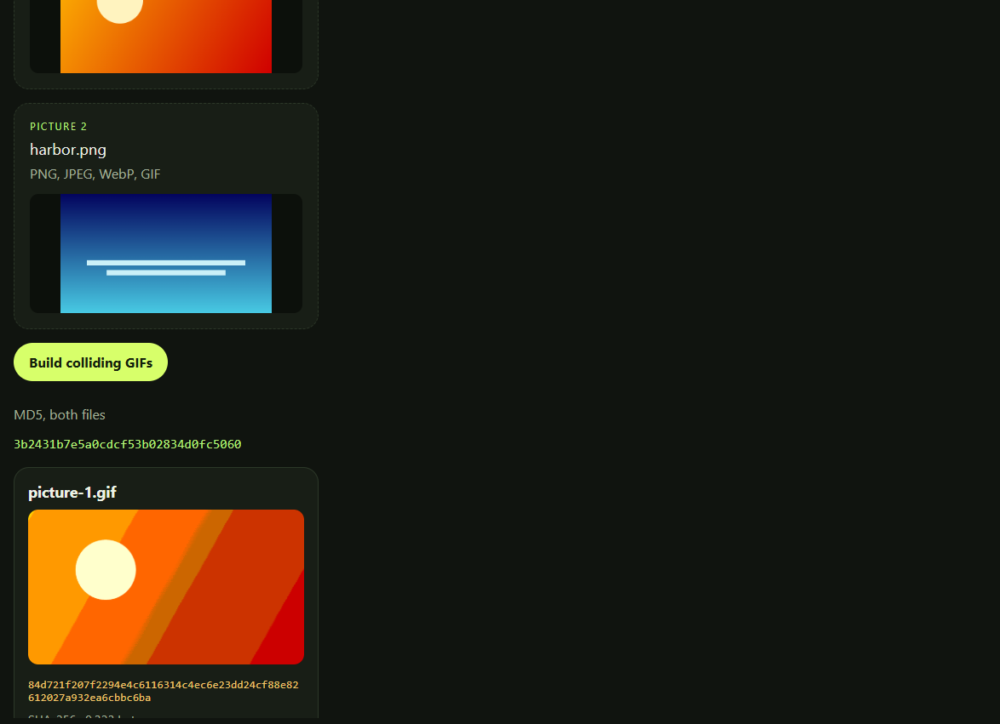

# MD5 collision demo

Two different files, one MD5. A local page where you upload two pictures, or generate a plain pair, and download both results. SHA-256 of the two files does not match.

The collision blocks come from [FastColl](https://www.win.tue.nl/hashclash/), Marc Stevens' identical-prefix attack. They were computed once and saved in `app/data`. Running the demo does not search for a new collision, and it does not try to hit an MD5 you already have.

The picture pair is a GIF. A comment length sits on a bit FastColl always flips, so one file shows the first picture and the other shows the second. Both pictures are stored in both files. Details, and the history through the 2008 rogue certificate and Flame in 2012, are in [docs/how-md5-broke.md](docs/how-md5-broke.md).

## Run

Python 3.11 or newer.

```bash
python -m pip install -r requirements.txt
python -m app
```

The page opens at http://127.0.0.1:8765. Nothing is uploaded anywhere. Set `MD5_DEMO_OPEN=0` if you do not want a browser window.



```bash
python -m unittest tests/test_collision.py
```

## Limits

The downloads are built for this demonstration. They are not the original files with a hash forced onto them. GIF viewers show one picture; the file that shows the first picture is a two-frame GIF whose first frame waits about 11 minutes, so it looks still. Some tools that only understand a single still image may behave differently. Use SHA-256 when a hash is supposed to identify a file.
